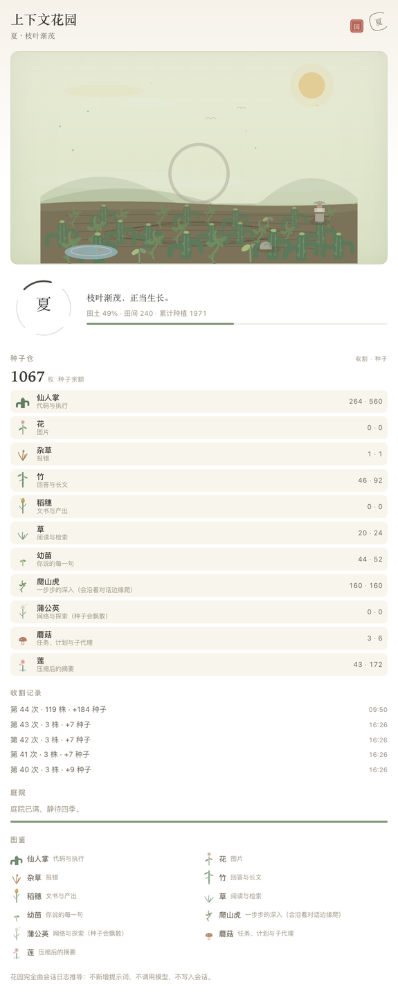
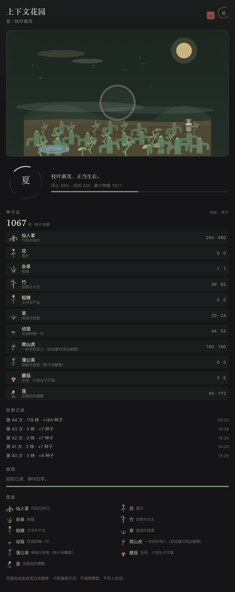
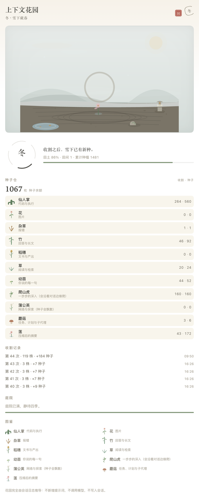
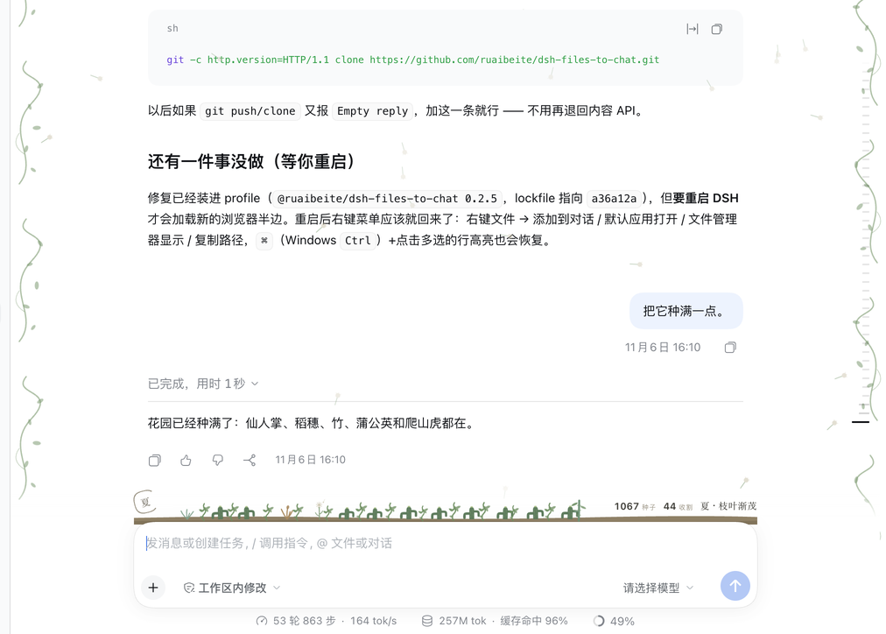

# dsh-context-garden · 上下文花园 🌱

> A zen garden for the context window. A DeepSeek Harness plugin.

**English:** Turn the context window into a zen garden: every message or tool result plants one of eleven plants (code = cactus, image = flower, error = weed, answer = bamboo, document = rice, web = dandelion, and more), each context compaction harvests the field into seed currency, and, as the session deepens, ivy climbs the chat's edges while dandelion seeds drift across it.

**中文：** 把上下文窗口种成一座禅意花园：每条消息或工具结果种下十一种植物之一（代码=仙人掌、图片=花、报错=杂草、回答=竹、文书=稻穗、网络=蒲公英……），每次上下文压缩就是收割季，植物化为种子货币；会话渐深时，爬山虎会沿对话边缘攀爬，蒲公英的种子在对话间飘散，田地随四季重新播种。

The garden is folded out of the session log the Harness already records. It adds no prompt, no tool, no model call and no session write; in v0.2.0 it opens no HTTP route either. Reopen the session, replay the log, or open it on another machine — the same garden grows back.

[中文说明 →](README.zh.md)

## At a glance

```
  session log events ──plant──▶  the field ──harvest──▶  seed warehouse
                                 11 species               by species
                                 ≤ 240 plants                 │
                                      │                  seeds accumulate
                              one lotus blooms                │
                              after each harvest              ▼
                                        lifetime 1 / 40 / 120 / 300 / 800
                                              → courtyard unlocks
```

Every user message, assistant reply with text, and tool result plants something; a text-less step that only calls tools grows an ivy. A context compaction is the harvest: the standing plants become seeds and the field is cleared — and then a single lotus blooms where the season ended, holding the compacted summary. The four seasons read how full the field is, and as the session deepens, ambient growth appears around the conversation.

## Species

| Plant | Fits | Planted when |
| --- | --- | --- |
| Cactus · 仙人掌 | code & execution | an assistant reply or user message containing a code fence; a code-writing tool result (shell, editor, patch, workflow…) |
| Flower · 花 | images | any message or tool result that carries an image |
| Weed · 杂草 | errors | a tool result marked `isError` |
| Bamboo · 竹 | answers & long text | an assistant reply with text and no code fence |
| Rice · 稻穗 | documents & deliverables | a document or presentation tool result (docx, pptx, xlsx, pdf, office, present, document) |
| Grass · 草 | reading & search | read / list / search tool results; unknown tools fall back here |
| Sprout · 幼苗 | your words | a user message without an image or code |
| Ivy · 爬山虎 | step-by-step depth | a text-less assistant step that calls a tool — the internal plumbing of an answer |
| Dandelion · 蒲公英 | web & exploration | a web tool result (web_search, web_fetch, fetch, browse) |
| Mushroom · 蘑菇 | tasks, plans & subagents | a coordination tool result (todo, plan, schedule, subagent, team, task, goal, ask_user) |
| Lotus · 莲 | the compacted summary | not planted by an event: one blooms in the field after every harvest |

Tool results are classified by tool name. The host half resolves the name from the session's own `tool/call` events and keeps that map on the host side only; the full mapping is `categoryOfTool` in `index.js`.

## Harvest and the four seasons

A context compaction (`compaction/start`) is the harvest. The plants standing in the field are weighed, converted to seeds, and recorded; the field is cleared and one lotus blooms in it. The lotus is the compacted summary — it stays through the winter and is taken by the next harvest, when it is worth 4 seeds (weight 400, base 1, lotus bonus +3). The session itself is untouched; only the garden's field state resets. The last 24 harvests are kept in the projection; the panel shows the most recent five.

Seasons are read from how full the field is, so the garden ages with the conversation:

| Season | When | What it looks like |
| --- | --- | --- |
| Spring · 春 | field occupancy `p < 0.38` | new shoots, pale sky |
| Summer · 夏 | `0.38 ≤ p < 0.62` | leaves thickening, a fuller field |
| Autumn · 秋 | `p ≥ 0.62` | heavy ears, warm light — close to the harvest line |
| Winter · 冬 | a harvest has happened and the field holds fewer than two plants — right after a harvest, just the lotus | snow on the soil and the lotus standing alone |

One line accompanies each season — 新芽初生 (New sprouts) · 枝叶渐茂 (Leaves deepening) · 秋意渐浓，穗实低垂 (Ears bend low, harvest near) · 雪下藏春 (Spring beneath the snow).

Field occupancy comes from the Harness's `contextPressure` (context used / context window). When the window size is not available, the season falls back to counting this round's plants: 0–8 spring, 9–18 summer, more autumn — an estimate, not a measurement.

## Two surfaces

### The garden bed on the composer

A full-width, borderless bed resting directly on the top edge of the composer card (`conversation.input.dock`, order 4, id `context-garden`). It has no card, pill, border or background of its own: the bed spans the composer's width, draws its soil as a thin strip along the input's top edge, and the plants grow straight out of it. On the left, a small enso holding the season character; across the width, up to 26 swaying SVG plants; on the right, the seed balance, the harvest count, and the season line (hidden on narrow windows). The whole bed is a single button: click it (or press Enter) to open the full garden. An empty bed shows bare soil and a small seed mound; the full panel shows the 待播种 line. When a harvest fires, the bed's plants fly up, the seed number rolls and the gain rises beside it; the full panel scene also drifts snow dust — for at most 2.6 s.

### The Garden tab in the right sidebar

A right-sidebar tab (id `@ruaibeite/dsh-context-garden/garden`, kind `context-garden`: registered with `sidebarRightTabs.register`, opened with `sidebarRight.openTab('context-garden')`). Its tab label reads 花园 / Garden. From top to bottom:

- the title and the current season with its one-line note; a vermilion seal carved 园 and a small enso sit in the corner;
- a large field scene (16:9, at least 168 px tall): sky, far hills, a sun disc, raked sand, and up to 30 plants placed by a stable hash; right after a harvest the single lotus stands in it; an empty field shows a quiet caption chip inside the scene;
- a 96 px four-season ring whose four arcs mark the seasons and whose center carries only the season character; beside it the season note, the field occupancy, the field and planting counts, a fill bar, and a 「收割将至」 hint once occupancy reaches 78% (not in winter);
- the seed store: the balance and one row for each of the eleven species with its harvested and seed counts, headed 收割 · 种子;
- the harvest log: the most recent five harvests;
- the courtyard: the next unlock and a progress bar toward it;
- the field guide: one row per species with its name and meaning;
- a footer note stating plainly how the garden is derived.

Both surfaces follow the Harness theme (`body[data-ds-dark-theme]`) and its `--dsw-alias-*` variables; their ambient animations are disabled under `prefers-reduced-motion: reduce`.

## Ambient growth

Two quiet effects grow around the conversation, never intercepting a click or a key (`pointer-events: none`), both folded from the same projection:

- **Ivy** — each internal tool-only step plants an ivy; as the lifetime ivy count grows, vine segments climb in from the left and right edges of the conversation, one segment per 40 ivy, up to 10 segments.
- **Dandelion** — each web excursion plants a dandelion; drifting dandelion seeds float across the conversation, growing with the lifetime dandelion count up to 30 seeds.

Both effects exist only once their plants do: ivy is common (any tool-only step), dandelions need web tools. Under `prefers-reduced-motion: reduce` the drifting seeds are not rendered and the vines hold still.

## Screenshots

The full-width garden bed on the composer — the season mark, the swaying bed of plants, the seed balance, the harvest count and the season line:


The Garden tab in summer, light theme:



The same tab in dark theme:



Right after a harvest: winter, snow on the bed, and the single lotus in the field:



Ambient growth: ivy climbing the conversation's edges and dandelion seeds drifting across it:



## Seeds and the garden

Each plant carries a weight estimated from the text it grew out of: `ceil(characters / 4)`, clamped to 1–4000. Reasoning text is not counted; a tool result weighs its text blocks.

```
seedValue = clamp(1 + floor(weight / 800), 1, 5) + bonus
bonus: flower +2 · lotus +3
       cactus / bamboo / rice / dandelion / mushroom +1
       ivy / weed / grass / sprout +0                 → a plant is worth 1–8 seeds
```

A small message is worth one seed; a heavy tool result is worth more. Flowers and the lotus carry the largest bonuses.

Lifetime seeds are a reading of the garden, not a currency to spend. They only accumulate, and each threshold reveals a small scene in the courtyard:

| Lifetime seeds | Unlocks |
| --- | --- |
| ≥ 1 | moss stone |
| ≥ 40 | stone lantern |
| ≥ 120 | koi pond |
| ≥ 300 | raked sand |
| ≥ 800 | moon gate |

## How it works

The host half (`index.js`) registers a session projection called `garden` (stateVersion 2, so stale v1 checkpoints are invalidated and the log replays through the eleven-kind logic) through `sessionProjections.register`, inside a `ctx.effect` that disposes cleanly. Its `apply` folds a handful of session-log events:

| Event | What it does |
| --- | --- |
| `tool/call` | remembers `callId → tool name` (bounded, host-only) |
| `tool/result` | plants one: error → weed, image → flower, otherwise by tool category (code → cactus, documents → rice, web → dandelion, coordination → mushroom, reading → grass) |
| `assistant/message` | text → bamboo, or cactus when the text contains a code fence; a text-less step that calls a tool → ivy; reasoning-only steps plant nothing |
| `user/message` | plants a sprout, a flower, or a cactus |
| `compaction/start` | harvests the field into seeds, then blooms a lotus |

`wire.view` strips the host-only call map before the state reaches the browser; the client reads it with `useProjection('garden')`, reads the Harness's `contextPressure` projection for the seasons, registers its own dictionaries with the locale service, and renders the two surfaces plus the ambient overlay. Projection caps: 240 plants in the field, 24 harvest records, 80 cached call names (host side). Damaged or missing state is repaired while parsing — the UI degrades quietly instead of failing.

Because every field is derived rather than stored, replaying a session log produces the same garden.

## Install

Three ways:

- **Market** — search for `dsh-context-garden` (or 上下文花园) in the storefront and install.
- **From GitHub** — `dsh plugin --profile <profile> add github:ruaibeite/dsh-context-garden`
- **From a local checkout** — `plugin_manager: install_bundle target=/path/to/dsh-context-garden`

The plugin row is injected by the package's own `cordis.patch.yml`; no manual patch edits are needed. Uninstall with `plugin_manager: remove_bundle` (or from the market), then restart the desktop app so the host half unloads.

## Verify

```sh
cd dsh-context-garden
npm test
```

No dependencies — 70 checks run on plain Node: 49 host tests and 21 render tests. `test/host.mjs` covers the projection (eleven-kind classification, every fold rule including ivy and the post-harvest lotus, seed math and conservation across a multi-season session, damaged-state repair, `apply()` with a fake context). `test/render.mjs` runs the client components in a small in-repo harness: the full-width bed with every species, seasons, milestones, the winter lotus, the harvest flash, the ivy/dandelion overlay builder, the missing-projection fallback, and the bilingual copy.

## Why it costs nothing

- **No model calls.** It adds no prompt, no model tool and no request.
- **No session writes.** The projection only reads the session log.
- **No network.** v0.2.0 registers no HTTP route and contacts no external service.
- **Replay-stable.** The same session log always folds into the same garden — reopen, replay, or open on another device.
- **Visual only.** No tools of its own and no settings surface; one session, one garden.

## Known limits (v0.2.0)

- A season's field keeps at most **240 plants**; older plants fall off the bed. The bed draws the 26 most recent of them and the panel 30. Planting totals still count every event, but a harvest converts only the plants still standing — plants that fell off do not become seeds.
- The season prefers `contextPressure`; without a context window size it falls back to counting this round's plants (0–8 spring, 9–18 summer, more autumn), so the season is an estimate.
- The ambient effects are honest about rarity: dandelions need web tools and rice needs document tools, so in an ordinary session those rows can stay empty and the drifting seeds may not appear at all; ivy needs only a tool-calling step and is common.
- If the locale bundle is missing or fails to load, the surfaces fall back to built-in copy instead of failing to render.
- The bed lives in an opened session's composer; the welcome page shown before any session exists renders no composer (and no composer dock), so the garden first appears once a session is open.
- One session, one garden: v0.2.0 has no cross-session overview, no settings page, and registers no tools.

## License

MIT — see [LICENSE](LICENSE).