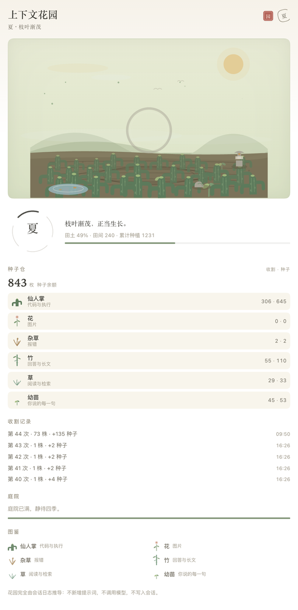
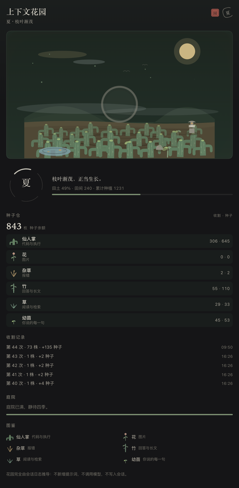
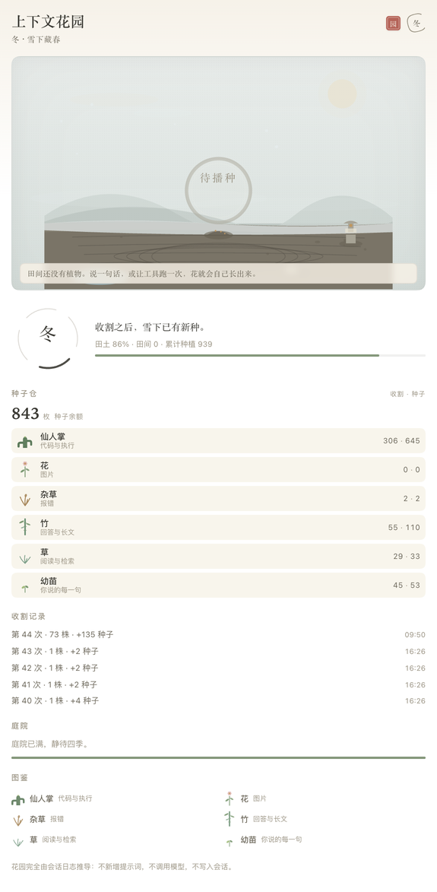

# dsh-context-garden · 上下文花园 🌱

> 把上下文窗口种成一座禅意花园 · DeepSeek Harness 插件

**中文：** 把上下文窗口种成一座禅意花园：每条消息或工具结果种下一株植物（代码=仙人掌、图片=花、报错=杂草），每次上下文压缩就是收割季，植物化为种子货币，田地清空后随四季重新播种。

**English:** Turn the context window into a zen garden: every message or tool result plants a plant (code = cactus, image = flower, error = weed), and each context compaction harvests the field into seed currency before it is replanted through four seasons.

花园完全由 Harness 已经记录的会话日志推导：不新增提示词、不注册工具、不调用模型、不写入会话；v0.1.0 也不新增任何 HTTP 路由。重新打开会话、重放日志、换一台机器，长出来的都是同一座花园。

[English →](README.md)

## 一眼看全

```
  会话日志事件 ──种下──▶  田地  ──收割──▶  种子仓
                         ≤ 240 株            按种类计
                                                 │
                                            种子累计
                                                 ▼
                                  终身 1 / 40 / 120 / 300 / 800
                                          → 解锁庭院小景
```

每条用户消息、带文字的模型回答、每个工具结果都会种下一株植物。一次上下文压缩就是一次收割：田里的植物化为种子，田地清空；之后的新消息继续种进空田，四季则读出田地的饱满程度。

## 物种

| 植物 | 对应 | 何时种下 |
| --- | --- | --- |
| 仙人掌 | 代码 | 含代码围栏的模型回答或用户消息；写代码类工具的结果（shell、编辑器、补丁、workflow…） |
| 花 | 图片 | 任何携带图片的消息或工具结果 |
| 杂草 | 报错 | 标记 `isError` 的工具结果 |
| 竹 | 回答 | 带文字的模型回答——只有推理与工具调用的步骤不种 |
| 草 | 阅读与检索 | read / 搜索 / 列目录类工具的结果；无法归类的工具也落在这里 |
| 幼苗 | 用户的话 | 不含图片与代码的用户消息 |

工具结果按工具名分类。Host 端从会话自己的 `tool/call` 事件里解析名字，这张映射只留在 Host 侧；完整分类规则是 `index.js` 里的 `categoryOfTool`。

## 收割与四季

一次上下文压缩（`compaction/start`）就是一次收割。田里站着的植物被称重、换算成种子并记账，田地回到裸土。会话本身没有任何改动——重置的只是花园的田地状态。投影里保留最近 24 次收割记录，面板展示最近的 5 条。

季节由田地的饱满程度读出，于是花园随对话一起生长：

| 季节 | 判定 | 画面 |
| --- | --- | --- |
| 春 | 田土占用 `p < 0.38` | 新芽初生，天色清浅 |
| 夏 | `0.38 ≤ p < 0.62` | 枝叶渐茂，田地更满 |
| 秋 | `p ≥ 0.62` | 秋意渐浓，穗实低垂——接近收割线 |
| 冬 | 收割过，且重新种下的植物不足 2 株 | 雪、裸土、种堆 |

每个季节配一句状态：新芽初生 · 枝叶渐茂 · 秋意渐浓，穗实低垂 · 雪下藏春。

田土占用来自 Harness 的 `contextPressure`（已用上下文 / 上下文窗口）。窗口大小不可用时，季节退回按本轮植物数估算：0–8 株春、9–18 株夏、更多则秋——这是估算，不是测量。

## 两个界面

### 输入框下方的花园矮栏

输入框下方一枚 27 px 高的紧凑胶囊（`conversation.composer.dock`，order 2，id `context-garden`）。左侧是一圈恩索，里面嵌着季节字；中间是 136 px 迷你园圃，最多 10 株随风轻摆的 SVG 植物；右侧是种子余额与收割次数，收割时得到的种子数会在旁边浮起。整枚胶囊是一个按钮：点击（或按 Enter）就打开完整花园。空床只画裸土与一小堆种子；「待播种」那句只出现在完整面板的场景里。收割发生的瞬间，矮栏里的植物往上飞、种子数字滚动、旁边浮出得到的种子数；完整面板的场景里还会飘落雪尘——最长 2.6 秒。

### 右侧栏的「花园」页签

右侧栏页签（id `@ruaibeite/dsh-context-garden/garden`，kind `context-garden`：用 `sidebarRightTabs.register` 注册，`sidebarRight.openTab('context-garden')` 打开），页签标题是「花园 / Garden」。自上而下：

- 标题与当前季节、一句季节注脚；右上角有一枚朱印「园」和一圈小恩索；
- 一幅大田景（16:9，至少 168 px 高）：天空、远山、日轮、砂纹土床，最多 30 株植物按稳定哈希散布；空田时场景底部浮出一条安静的说明；
- 一枚 96 px 的四象限四季圆环：四段弧表示四季，圆环中心只有季节大字；旁边是季节注脚、田土占用、田间株数与累计种植、一条进度条，以及占用到 78% 时出现的「收割将至」；
- 种子仓：种子余额，以及六种植物各自的收割数与种子数，表头是「收割 · 种子」；
- 收割记录：最近五次收割；
- 庭院：下一个解锁目标与进度条；
- 图鉴：六种植物各一行，名字与含义；
- 页脚：如实说明花园由什么推导而来。

两个界面都跟随 Harness 主题（`body[data-ds-dark-theme]`）与 `--dsw-alias-*` 变量；环境动画在 `prefers-reduced-motion: reduce` 下停用。

## 截图

输入框下方的花园矮栏——季节圆、迷你园圃、种子余额与收割次数：


夏季的花园页签（浅色主题）：



同一页签的深色主题：



收割之后入冬：雪下空田，场景里写着「待播种」：



## 种子数学与庭院解锁

每株植物带一个重量，由它生长时附着的文字估算：`ceil(字符数 / 4)`，夹在 1–4000。推理文字不计入；工具结果计入它的文本块。

```
seedValue = clamp(1 + floor(weight / 800), 1, 5) + bonus
bonus：花 +2 · 仙人掌 +1 · 竹 +1 · 其余 0       → 一株植物值 1–7 枚种子
```

一句小消息值 1 枚种子，一份沉重的工具结果值更多；花的加成最高。

终身种子是对花园的读数，不是可以花掉的货币：它只增不减，每到一个门槛就露出一处小景：

| 终身种子 | 解锁 |
| --- | --- |
| ≥ 1 | 苔石 |
| ≥ 40 | 石灯笼 |
| ≥ 120 | 小池 |
| ≥ 300 | 枯山水 |
| ≥ 800 | 月洞门 |

## 它是怎么工作的

Host 侧（`index.js`）通过 `sessionProjections.register` 注册一个名为 `garden` 的会话投影（stateVersion 1），注册与清理包在 `ctx.effect` 里。它只折叠少数几类会话日志事件：

| 事件 | 处理 |
| --- | --- |
| `tool/call` | 记住 `callId → 工具名`（有上限，只留在 Host 侧） |
| `tool/result` | 种一株：报错 → 杂草、图片 → 花，其余按工具分类 |
| `assistant/message` | 种竹；文本含代码围栏时种仙人掌；只有推理的步骤不种 |
| `user/message` | 种幼苗、花或仙人掌 |
| `compaction/start` | 收割田地，化为种子 |

`wire.view` 在状态送到浏览器之前去掉只属于 Host 的调用映射；客户端用 `useProjection('garden')` 读取，并用 Harness 的 `contextPressure` 投影判断四季，同时向 locale 服务注册自带词典，再渲染两个界面。投影上限：田里 240 株、最近 24 条收割记录、80 条调用名缓存（Host 侧）。损坏或缺失的状态会在解析时修复——界面安静降级，不会崩掉。

因为一切都由推导而来而不是存储，重放同一份会话日志会得到同一座花园。

## 安装

三种方式：

- **市场**：在市场里搜索 `dsh-context-garden`（或「上下文花园」）一键安装；
- **GitHub 源码**：`dsh plugin --profile <profile> add github:ruaibeite/dsh-context-garden`；
- **本地目录**：`plugin_manager: install_bundle target=/path/to/dsh-context-garden`。

插件行由包内自带的 `cordis.patch.yml` 注入，不需要手改 profile 的 patch 层。卸载：`plugin_manager: remove_bundle`（或市场里卸载），然后重启桌面端让 Host 侧卸载。

## 验证

```sh
cd dsh-context-garden
npm test
```

没有依赖——61 项检查都用纯 Node 运行：44 项 Host 测试 + 17 项渲染测试。`test/host.mjs` 覆盖投影（工具分类、每一条 fold 规则、种子数学与收割、坏数据解析修复、用假 ctx 驱动 `apply()`）；`test/render.mjs` 用仓内的小型 harness 运行真实客户端组件：矮栏与面板渲染、四季、里程碑解锁、收割动画触发、无投影降级，以及中英文案。

## 为什么零开销

- **零模型调用**：不新增提示词、不注册模型工具，也不发请求。
- **零会话写入**：投影只读会话日志。
- **零网络**：v0.1.0 不注册 HTTP 路由，不访问任何外部服务。
- **可复现**：同一份会话日志永远折叠出同一座花园——重开、重放、换设备都一样。
- **只是视觉**：没有自己的工具，没有设置页；一个会话，一座花园。

## 已知限制（v0.1.0）

- 一季的田地最多保留 **240 株**，更早的植物会从田里掉出去；面板只画最近的 30 株，矮栏只画最近的 10 株。种植总数仍统计每一次事件，但一次收割只换算还站在田里的植物——掉出去的植株不会变成种子。
- 季节优先读 `contextPressure`；拿不到上下文窗口大小时，退回按本轮植物数估算（0–8 株春、9–18 株夏、更多则秋），此时季节是估算值。
- locale 缺失或加载失败时，界面改用内嵌文案，而不是渲染失败。
- 矮栏长在已打开会话的输入框下方；还没有任何会话时的欢迎页没有 composer dock，因此花园要在打开一个会话之后才会出现。
- 一个会话，一座花园：v0.1.0 没有跨会话总览、没有设置页，也不注册工具。

## License

MIT，见 [LICENSE](LICENSE)。